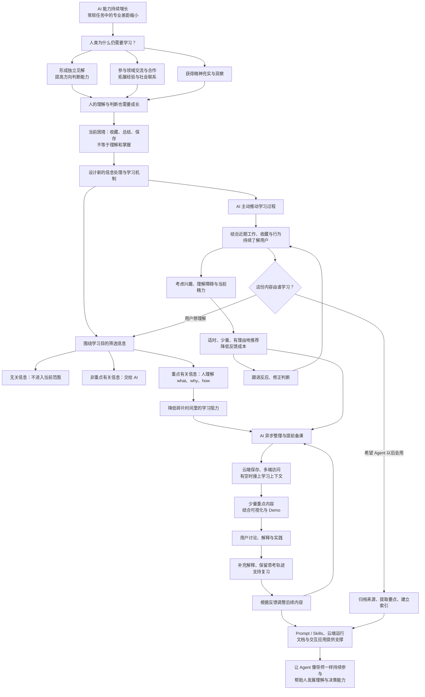

随着 AI 能力的增长，越来越多的专业工作正在被重新定义。即使是依赖物理世界的嵌入式、自动化等领域，AI 对物理世界的理解进一步增强，可能也只是时间问题，目前的限制之一是高质量数据还不够充分。生物、化学中那些先提出猜想、再推理和验证的工作，也未必会长期构成 AI 难以跨越的障碍。

有人因此认为，未来人们说不定都会去学习写作优秀的百合作品 cc @邓煜。但在我看来，现在的模型没有表现出更强的文学能力，也可能只是因为继续优化这类能力的收益不高，各个模型厂商还未在这个维度上去进行特别充分的对齐。目前的语言能力，已经足以支持它们与人清晰地交流工作内容，却未必代表其上限。

那么，人类还需要学习吗？我认为当然需要。

前面讨论的学习，大多带有明确目的：为了解决某个实际问题，掌握相应的技术和方案。随着 AI 能力增长，专业人员与非专业人员在完成常规任务上的差距，可能会逐渐缩小。但专业人员依然具有领域优势，这种优势不只体现在能否亲手完成某项工作。

首先，领域知识会影响一个人如何与 AI 交流。不了解某个领域的人，往往只能问：“有什么想法？”“有什么推荐？”“哪种方案更好？”在这种交流中，人主要是在被动接收 AI 的输出。即使有明确的解决问题的目标，其探索范围也很容易受限于模型提供的选项。

对领域有一定理解的人，则能够提出自己的见解，与 AI 讨论、质疑和推演。AI 成为一个可以快速交流想法的对象，而这种双向交流又会反过来锻炼人的思维。**自己的大脑，以及其中积累的经验和理解，是每个人独有的上下文资源。**

领域积累也有助于人判断探索方向：现实环境下什么是必要的，什么可以暂时不做，当前的重点在哪里，之后还有哪些可能的路径。视野更广的人，也更有机会发现 AI 没有注意到的细节，并将这些信息反馈给它。因此，学习一个领域，仍然能够提升人提出问题、选择方向和解决问题的能力。

其次，人生活在现实社会中。思考方式和解决问题的能力，本身就具有社会价值，也可能帮助人获得更多资源，尤其是领域内的社交资源。学习不仅让人掌握新东西，也让人与他人产生联系，让别人看到自己的价值。相较于领域外的人，有积累的人更容易参与深入交流、建立合作关系，而这些交流又会继续拓展他独有的经验与理解。

此外，学习还有许多难以清晰衡量的非功利价值，例如精神上的充实，以及对事物更深入的洞察。

这些也是我对当前一些“AI 辅助学习”方式感到不满意的原因。很多人阅读文章、参与实践之后，会让 AI 总结，再将结果沉淀成文档、知识库或 Skills。AI 留下的材料越来越多，但人自身未必获得了相应的提升。即使一个项目宣称能够沉淀“个人知识”，如果用户保存之后从未认真看过、思考过，这些内容也很难称得上是他已经掌握的知识。

因此，我想围绕 AI 时代的信息特点，设计一套面向高效信息获取与学习的处理机制。

首先，人并不需要学习所有信息。围绕一次具体的学习，可以把信息分成三类：无关信息、非重点有关信息，以及重点有关信息。

有关和无关，需要根据学习目的来判断。比如，准备学习一篇文章时，应该先明确：究竟想从中了解什么？关注的是哪个问题？与这个目的有关的内容，才进入当前的学习范围。这样才能缩小上下文，避免被材料里的所有细节牵着走。

在有关信息中，还需要进一步区分：哪些可以交给 AI 处理，哪些需要人亲自理解。比如编程语言的语法规则，可以借助技术文档、编译器和解析器，让 AI 处理。这些细节可能影响任务完成，但不一定需要占据学习者的主要注意力。人更应该关注的是：这个想法是什么，为什么会提出它，以及它是如何实现的，也就是 what、why、how。

以学习 Codex 的压缩机制为例。一个技术爱好者打开 Codex 开源仓库，目的是理解压缩，那么 OAuth、UI 等其他部分就不属于当前重点。AI 为了理解和定位代码，需要知道功能被拆分在哪些函数中，各部分如何组成完整机制。但对学习者而言，函数的具体名称、使用的编程语言或第三方库，并不一定是这次学习的重点。他首先需要理解的是：压缩想解决什么问题，为什么要这样做，会产生什么影响，以及具体机制如何运作。

明确了学什么，还需要解决怎么学。

今天的信息来源很多，但我们经常只是草草看一眼，给仓库点个 Star，把文章或视频加入收藏夹，之后便没有再打开。偶尔想起来，又发现内容太长，于是交给 AI 总结。可 AI 的总结仍然是一大篇，看了一点就失去耐心；即使读完，也可能很快忘记。再把总结存进知识库，容易产生一种“已经学过、已经记住”的感觉，但以后仍然想不起来。

这里的困难之一，是理解复杂内容往往需要持续投入注意力，而现实生活很容易打断这种投入。并不是每个人都有大段空闲时间，也不是每个人都容易进入心流，或能够长时间保持学习状态。

我们不应该把“能够坐很久研究问题”视为唯一正确的学习方式。我更想探索的是：**当一个人突然有学习意愿时，能否让他迅速进入学习状态，接上相关上下文，在有限时间里完成一部分有意义的理解。** 这种方式更适合碎片化、快节奏的生活，也能照顾那些学一会儿就感到疲惫的人。

为此，AI 可以先异步处理用户收藏的文章、视频和项目，将它们从“待 AI 处理”推进到“待人学习”。用户收藏时不必立即开始学习，AI 也不必一次性生成整套内容，而可以随着人的进度逐步准备。

等用户有空，或者突然想学时，便可以从清单中选择一个想推进的主题，直接进入 AI 已经准备好的内容。要做到随时随地开始，这套机制需要依托云端运行环境，并支持多端访问同一份资源和学习进度。

学习过程中，每接收一部分内容，都应该能够随时展开讨论。这个输出过程很重要：它能帮助 AI 了解用户究竟理解了什么、卡在哪里，也能为后续内容调整，以及是否需要在适当的空闲时间邀请用户回顾，提供依据。

至于内容的表现形式，已经有很多可用的方法：用 Skills 约束表达，让解释更接近日常语言；用可视化呈现复杂流程和关系；用 Demo 展示创意或机制。但最重要的仍然是抓住重点。

AI 生成内容又快又多，人却没有足够的注意力去解析大段看似流畅、实际难以吸收的文字。对学习场景而言，少而准确的输出更有价值。可视化有助于形成印象，但如果用户看完之后仍然无法抓住重点进行叙述，那它可能只是一张排版精美的海报。

这也引出了一个问题：这样的机制，与随时把链接发给 GPT 或 Claude，让它处理、生成 Artifact，再通过连接器保存下来，有什么区别？

从操作步骤看，两者确实有很多相似之处。区别在于，整个过程由谁持续推动。

过去通常需要用户不断告诉 AI 下一步做什么。而我希望，AI 能主动承担更多准备和衔接工作：用户转发一批链接后，它在后台整理、备课；用户有空打开时，可以直接开始；阅读过程中发现某处解释不清楚，读了两遍仍然没懂，也能立刻展开讨论。

讨论之后，AI 应该根据用户实际的理解程度和表达偏好调整后续内容。每个人对“说人话”的要求并不相同，这需要在交流中逐渐了解。同时，AI 可以将新的解释作为补充，嵌入当前学习文档，保留用户提出的问题、原来的理解和后续的变化。

**用户自己的思考过程，应该成为学习材料的一部分。** 日后复习时，看到“我当时为什么没懂，后来是怎样理解的”，可能比重新阅读一份干净的 AI 总结更有价值。

我觉得飞书可以作为这个过程的一种承载方式。文档支持丰富的表现形式，文档之间也能相互嵌入。如果能够结合 HTML 嵌入和沙箱信息注入，就会有更多交互上的可能。再加上 lark-cli 对 Agent 调用的支持，以及豆包工作与飞书、手机端、云端和 PC 端之间的连接，用户就有机会随时与 AI 一起访问自己的知识库。

当然，这条路线也有我不满意的地方，例如闭源、Agent 运行框架的使用体验，以及订阅成本。Agent 层未必必须依赖豆包工作，开源版 lark-cli 虽然有所限制，但也可能已经足以支持主要流程。关键仍然是机制：减少用户反复解释意图的成本，并打通学习过程中的交互。

我希望 AI 在这里更像一位导师，能够提前铺垫、主动推进，减少开始学习的阻力，帮助人维持学习意愿。

一个常见的场景是：上班族白天听了一场直播，用转录软件保存了记录；工作间隙又看了几篇技术博客，在 B 站收藏了几个视频。晚上回到家已经很累，没有再打开白天觉得有意思的内容，洗漱后玩一会儿手机便睡了。一天接触了很多信息，但这些信息之后可能再也没有被用到。

很多人很难在长期感受不到反馈的情况下坚持自律。打卡之所以有吸引力，也在于它让人看见自己坚持了多久、完成了哪些阶段。学习同样需要能够被感知的反馈。

现在一些厂商开始探索 Personal Agent，在长任务执行和定时任务的基础上，增加主动推送能力。从实现角度看，这类主动行为仍然需要外部事件或 Hooks 触发，只是触发来源更加丰富。

但我更关心的是：Agent 在帮助人更好地完成“how to do”的同时，能否也帮助人提升“what to do”的判断能力？

Agent 执行任务时，需要理解人的目标和意图。如果它的能力与工作范围不断增长，而人的思考和判断没有同步发展，人就可能越来越难以引导它。在我看来，目前的 Agent 在长任务中仍然容易选择比较保守、中庸的路径，有时需要人提出一个更大胆、可能正确的方向，才会继续探索。

对于大多数只能使用大众商业模型的人而言，单纯依赖模型提供的答案，也很难形成超出普遍水平的独特判断。因此，即使在 AI 时代，人依然需要参与关键决策。那些可以完全脱离人的任务，往往本身就具有较强的流程化、机械化特点。

现有的记忆框架、项目文档和 Skills，已经在帮助 Agent 适应用户。但我还想进一步追问：能否让 Agent 持续帮助用户发展自身能力，尤其是作为关键决策者所需要的能力？

这意味着，Agent 需要结合用户近期的工作、关注内容和行为，适时提供少量、相关的学习内容。开会时推送，用户大概率不会看；一次发来一堆文章，同样会造成负担。

而且，推送之后还需要继续了解效果。可以先从用户主动关注、收藏的内容入手，例如白名单中的博客、视频网站、个人知识库和收藏目录，再逐步尝试其他内容。

用户没有点击，是不感兴趣，还是当时很忙？用户在某一段停留很久，是对它感兴趣，还是解释太难理解？看过几篇文章、几个视频后，他究竟对哪些内容更投入？这些行为都值得关注，但不应该被简单解释成某个确定的兴趣标签。

用户可能长期从事领域 A，却对领域 B 更有热情；也可能曾经对某个方向非常投入，后来兴趣逐渐减弱，只是还没有完全放下。因此，推荐既可以围绕最近的主动关注，也可以少量尝试过去的兴趣，了解它是否仍然存在。还可以从已有兴趣之间的关系中，探索用户未来可能感兴趣的新方向。

要采集页面停留时间、区域停留和交互轨迹，可能确实需要一个专门的应用。但推荐只是其中一部分。推荐之后，Agent 还应该继续参与学习，例如：

> “你最近在看这篇文章。看完之后，有空可以一起回忆几个关键点。”

> “这篇你似乎没有继续读，是题材不太感兴趣，还是解释不容易理解？”

> “我发现一个与你最近关注的方向有关的新领域，已经整理了一点内容，可以先看看它们有什么联系。”

> “你前面关于 Transformer 的几个问题还没有弄清楚，现在这篇又会用到相关概念。可以先补一下，再继续了解注意力残差。”

在这个场景里，用户希望 Agent 主动了解和准备。只有它先做了一些探索，用户才更容易判断自己是否值得继续投入。

具体而言，我希望这套机制具备以下能力：

1. **提供有理由、有节制的个性化推荐。** 学习会消耗精力，推荐需要解释为什么值得当前这个人关注，也需要考虑他已经在学什么、还有多少精力。不能因为用户多停留了几秒，就认定他对某个领域有强烈兴趣，更不能一批接一批地推送。

   交互也应尽量轻便。用户疲惫时，往往不愿意打字回答问题。清晰的选项、按钮或可视化表单，可以降低反馈成本。用户没有继续互动时，系统也应考虑时间、疲劳和兴趣变化等不同可能，而不是立即下结论。

2. **主动帮助用户开始学习。** 当收藏清单相对稳定，且用户近期表现出明确意愿时，Agent 可以提前准备。比如用户想学习 PyTorch，系统可以在获得相应信息后，结合日程或平时的生活习惯判断可能的学习时段，必要时用简单的问题了解安排。

   后台准备也不应限于写一份学习清单，还可以包括搭建环境、准备初始实验脚本。这样，用户晚上有空时就能直接学习和实践，减少把全部精力耗在准备工作上的情况。

3. **通过用户输出了解学习效果，并保留学习路径。** 除了输入内容，还应邀请用户解释、讨论或尝试应用。用户的输出能帮助 Agent 了解他的掌握程度和学习偏好，也能留下真实的思考过程。日后回看时，这些记录比一份完全由 Agent 写成的总结，更有机会唤起当时的理解。

4. **区分“人要学”和“交给 Agent 学”。** 用户收藏的内容，不一定都是自己想深入了解的。有些文章只是希望 Agent 以后工作时能够参考，例如《Agent Browser 代替 Playwright》或《React 最佳实践》。

   当上下文表明用户有这样的意图时，Agent 可以归档原文或视频字幕，提取要点，并在记忆中建立索引，供后续任务使用，而不把它们都变成人的学习负担。意图不明确时，再以尽量简单的方式确认。

我最终想做的，是让 Agent 在处理信息的同时，持续关注人的学习是否真的发生。它需要知道什么时候准备、什么时候邀请、什么时候解释，也需要从用户的回应中调整后续安排。这样，AI 所积累的文档和能力，才能与人的理解和判断一起成长。

下面这张图概括了全文的行文思路：

